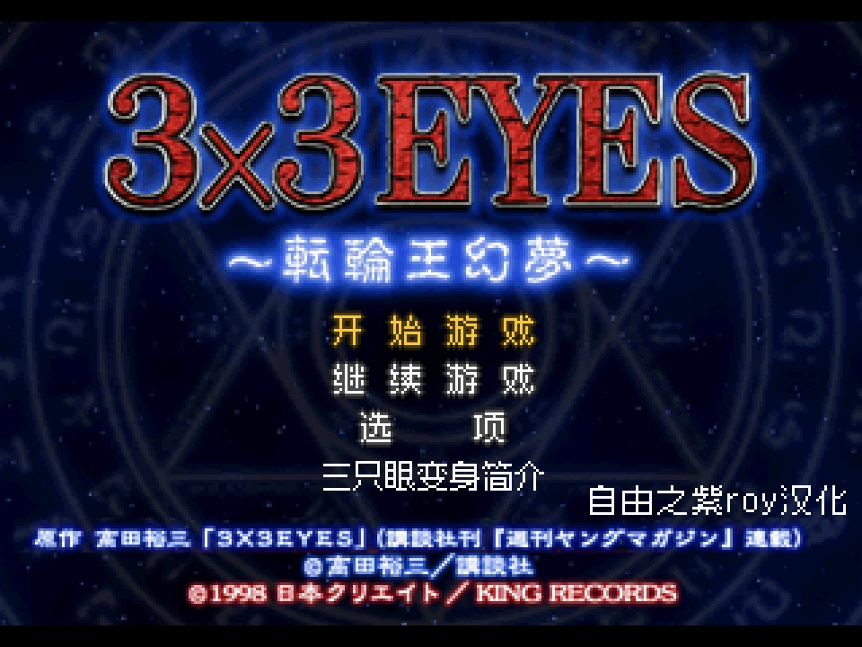

# 三只眼 转轮王幻梦 · 简体中文汉化 v1.1

**3x3 EYES 〜転輪王幻夢〜 ／ 3x3 Eyes: Tenrinou Genmu**
PlayStation · 日版三碟装（SLPS-01497 / 01498 / 01499）· 简体中文补丁

作者 **自由之紫Roy** ｜ 本版 **v1.1** ｜ 2026-11-02



**下载**：[Releases → v1.1](../../releases/tag/v1.1)　｜　**安装**：[docs/patch-guide.md](docs/patch-guide.md)　｜　**校验值**：[SHA256SUMS.txt](SHA256SUMS.txt)

本仓库只放**补丁、文档与截图**：不含游戏本体，不含 BIOS。你需要自备日版原盘。

---

## 写在前面：三十四年前的一本书

1980 年生人。第一次翻到《3×3 EYES》是 1992 年，十二岁。

那会儿学校门口有个书摊，五块钱一本，厚的那种。纸是黄的，油墨发灰，封面常常糊成一团分不清谁是谁，页边裁得歪，偶尔中间还夹着两页重复、一页不知去向。它就是这么来到我手上的——不是什么体面的版本，但我一翻开就没放下。

吸引我的不是打斗，打斗其实看得云里雾里。是那种"安静下来更可怕"的东西：佩脖子上挂着封印，第三只眼一旦睁开，那个小女孩会变成叫人不敢看的东西；八云本来只是个普通人，为了留下来，把自己变成了佩的「无」——从此不死、不伤，也再回不去普通人的活法。恐怖的部分和温柔的部分是同一件事，这在当年的漫画里很少见。还有那些妖怪，画得很脏、很慢，不像后来那些干净利落的怪物，它更接近你夜里真的会怕的那种东西。

后来手里有钱了，一册一册地补：台版、港版，各买过一套。盗版翻烂了，台版留着没舍得裁开，港版是补漏的。三种版本摊开在同一张桌上，翻译的口气彼此不一样，有些句子对不上，我就找一个自己最认的说法。那时候没人教过我日文，全靠汉字硬猜。

再往后是 1998 年。十八岁，攒钱买下这张三碟装的光盘。

日文。我一个字都看不懂。

但我打完了——靠汉字、靠动画留下的记忆、靠一遍遍读档重来，硬把剧情拼出来。那天夜里我记得很清楚：不敢关机，怕存档丢；换碟时手心出汗，怕买到坏盘；打到某一段，明知道看不懂对白，还是坐在那儿看了很久。

心里想的是：**如果哪天能看懂它说什么就好了。**

2026 年，三十四年前的那本书、二十八年前的那张盘，被我自己翻成了中文。

所以这个补丁对我不是一个"项目"。它更像一份作业——**交还给当年那个看不懂剧情、却非要打完的十八岁的自己。**

顺便说明：我不敢说这是最早的公开汉化，之前有没有人做过、做到哪一步，我并不清楚。如果你知道更早的版本，欢迎开 issue 告诉我。

---

## 一、下载

三个补丁在 **Releases → v1.1**，单文件直下，不用拼分卷：

| 碟 | 文件 | 大小 | 对应原盘 |
|---|---|---|---|
| Disc 1 | `3x3Eyes_Disc1_zh_v1.1.ups` | 224.1 MiB／234,993,256 B | SLPS-01497 Track 1 |
| Disc 2 | `3x3Eyes_Disc2_zh_v1.1.ups` | 315.8 MiB／331,089,513 B | SLPS-01498 Track 1 |
| Disc 3 | `3x3Eyes_Disc3_zh_v1.1.ups` | 355.6 MiB／372,847,304 B | SLPS-01499 Track 1 |

国内直连 GitHub 有时会卡住。把链接前面加 `https://gh-proxy.com/` 再下：

```
https://gh-proxy.com/https://github.com/realsquall1980-art/3x3-eyes-tenrinou-genmu-zh/releases/download/v1.1/3x3Eyes_Disc1_zh_v1.1.ups
```

**下完先对 SHA-256**（见根目录 `SHA256SUMS.txt`，或第五节）。对不上说明没下完整，重新下，别拿去打补丁——补丁半截损坏时，打补丁工具报的错和"底包不对"是同一句话，容易误判。

## 二、安装（四步）

### 1. 核对底包

补丁是 **UPS 一步差异补丁**：直接打在**日版原盘的 Track 1.bin** 上，不需要任何中间版本、不需要先装别的东西。

| 碟 | 原盘 | 底包 CRC32 | 底包 SHA-1 |
|---|---|---|---|
| Disc 1 | SLPS-01497 Track 1 | `9880cffa` | `22c8248fae3346c5106cd14da14d9d4586119de5` |
| Disc 2 | SLPS-01498 Track 1 | `be2ecda1` | `c171f39c0da86bf6fe9e9e8d728b431ca060eadf` |
| Disc 3 | SLPS-01499 Track 1 | `9e61224f` | `c0db94774970fbc339dcbb22d30594bda6134cc4` |

对不上就是拿错了盘（别的区版本、rip 版、或者这张盘已经打过补丁）。完整 SHA-256 见 [docs/patch-guide.md](docs/patch-guide.md)。

### 2. 打补丁

- **Windows**：RomPatcher.js（网页版，把补丁和 bin 拖进去即可）或 UPS Patcher
- **macOS / Linux**：`flips`

```bash
flips --apply 3x3Eyes_Disc1_zh_v1.1.ups "Disc1/Track 1.bin" "Disc1/Track 1 (zh).bin"
# 打完把结果覆盖回 Track 1.bin 的原名（先备份原文件）
```

工具回话对照：

| 回话 | 意思 |
|---|---|
| `The patch was applied successfully!` | 成功 |
| `This patch is not intended for this ROM` / `source file is invalid` | **底包不对**（拿错碟／拿错版本／已经打过），不是补丁坏了 |
| `patch is already applied` | 这张盘已经打过了 |

只改 **Track 1.bin**。音轨和 `.cue` 不要动、不要改名。

### 3. 运行

1. 三碟都打好后，用模拟器打开 **Disc 1 的 `.cue`**（不是 bin 本身）。
2. 换碟：游戏提示换碟时，用模拟器的「更换光盘 / Disk Control」**追加** Disc 2、Disc 3 的 `.cue`；不要关掉模拟器重开，会丢存档状态。
3. 存档：本作把存档写在记忆卡镜像里。早期版本的旧存档和新字表码位不兼容，存档槽下方那行说明会显示成怪字——**覆盖重存一次即可恢复中文**，不用删档。

### 4. 掌机 / 前端只吃 CHD 的

```bash
chdman createcd -i "Disc1.cue" -o "Disc1.chd"     # 三碟各转一次
```

再用 `.m3u` 串起来（模拟器打开 m3u，不要打开单个 chd）：

```
3x3eyes_zh.m3u
  Disc1.chd
  Disc2.chd
  Disc3.chd
```

本仓库**不提供 CHD 成盘**（它等同于原版盘内容），只提供 UPS 补丁，CHD 请自己用打好的盘转。

## 三、这一版汉化了什么

| 部分 | 状态 |
|---|---|
| 剧情对白 / 旁白 | 中文 |
| 过场动画字幕（18 段 695 句，中日双语） | 中文＋日文对照 |
| 标题画面四行菜单 | 中文 |
| 标题末行「三只眼变身简介」＋署名「自由之紫roy汉化」 | 中文（本版重做） |
| 游戏内暂停菜单六项：存档／读取／选项／人物介绍／所在地说明／返回 | 中文 |
| 存／读档界面：标题、槽位、确认框、是／否、底部说明栏 | 中文 |
| 人物介绍屏（角色名＋正文） | 中文 |
| 所在地说明屏（地名＋正文） | 中文 |
| 角色名牌 | 中文（细体像素字） |
| 选项页 `AUDIO / BGM / VOICE / メッセージ表示 / 非表示` | **仍是原文**（盘上图片字，本版未改） |
| 「三只眼变身」图文精选整节 | **日文原文**（图片字，未改） |
| 片名美术字 3×3 EYES 〜転輪王幻夢〜 | 保留原文 |

## 四、v1.1 相对上一版（v7.3）改了什么

1. **暂停菜单「存档／读取」居中**。引擎是按"有效字数"把一行 144 像素平均分的，两字标签天然比四字标签靠左，六行首字尾字对不齐。本版把这两格的空格从句首挪到字间（`[存][空][档]`），长度、终止符、零码个数、非零码集合**全部保持原样**，块中心落到和其余五行一致的 159 像素。
2. **标题末行重做**：由 8 字改为 7 字「三只眼变身简介」，去掉渐晕，笔画变细、字距松开（此前 8 字塞进 84 像素，字被压小）。
3. **署名改为「自由之紫roy汉化」**，去掉日期，移到画面右下角，不再和中间的字挤在一起。
4. **补丁全部重做**：三碟按 UPS 规范重新编码，并用第三方 `flips` 实打验证——三碟打完后成品 SHA-256 与本机构建逐一完全相同；反面验证（D1 补丁打 D2 原盘）会被正确拒绝。

前一版 v7.3 有两个已修正的问题，列在 [CHANGELOG.md](CHANGELOG.md) 里：旧版补丁编码不合规导致常规工具一律装不上、旧补丁底包其实是未公开的中间版本。

> **v7.4 是作废版本**。它为对齐做了一次会改变文本链结构的写入，在部分设备上导致对话／菜单／存读档说明的文字整片消失。v1.1 不含该改动。

## 五、校验值

补丁（SHA-256，与 `SHA256SUMS.txt` 同源）：

| 文件 | SHA-256 |
|---|---|
| `3x3Eyes_Disc1_zh_v1.1.ups` | `81cdc7f2c2ec8d7be281f374779004aca9b4c0b2af6d4a3e67fbba8b06664bd1` |
| `3x3Eyes_Disc2_zh_v1.1.ups` | `b73c4b15b04058e172c4bcc166660545910c61b8a19c6e44aaf0286f935d5ad3` |
| `3x3Eyes_Disc3_zh_v1.1.ups` | `f8036ea9007f3c8ea5db6de74ac4ec17712390808ea75be6f329cf213c4c85a9` |

打完补丁后的成品 Track 1.bin（想确认"补丁是否打对了"可以核这个）：

| 成品 | SHA-256 |
|---|---|
| Disc 1 成品 | `19f111c0ca22bdc54ecae63d75e974f0b25f8c534066f684c47d590c577940c4` |
| Disc 2 成品 | `5cf79fa0a6956c189b07d125b0314dbacbd22bd4babd55c92a47575bde9e91c0` |
| Disc 3 成品 | `8002d029089a132c25b7bae8a253dd1cc32844ece77bb81ed01ef2c7ff4beedd` |

```bash
shasum -a 256 -c SHA256SUMS.txt      # macOS / Linux
certutil -hashfile 3x3Eyes_Disc1_zh_v1.1.ups SHA256   # Windows
```

## 六、已知问题与下一版计划

1. **存档槽缩略图不出图**（下一版 v1.2 处理）。槽位方框读的确实是记忆卡里的数据，但本版验证用的存档是在黑屏画面下存的，卡里那 768 字节缩略图区全是 0，所以"有彩色缩略图"这件事**没有拿到屏幕证据**。v1.2 会用明亮场景的存档重新取证。
2. **选项页与「三只眼变身」图文精选仍是日文**：这两处是盘上的图片字，不是文本串，要改得重绘字块，本版没做。
3. **真机验证边界**：v1.1 的屏幕证据来自 PCSX-ReARMed（与掌机前端同款内核）无头回放——四屏（所在地说明正文／标题／存档屏槽位与说明栏／六行菜单）与上一版逐像素比对 Δ=0。Disc 1 已制成 CHD 并放进掌上设备，但**本版还没有拿到真机回报**；Disc 2、Disc 3 的逐屏实拍也未做。
4. **存档兼容**：早期版本的存档需要覆盖重存一次才会显示正确中文说明。

## 七、版权与致谢

- 游戏与漫画的一切权利属于原作者 **高田裕三** 及各权利方。本仓库只含**差异补丁、文档与截图**，不含游戏本体、BIOS 或完整镜像。
- 文档以 **CC BY-NC 4.0** 发布；补丁仅供个人学习、备份与自己手上的正版盘配合使用，请勿用于贩卖。
- 致谢：高田裕三（原作）、Redump（原盘校验基准）、Alcaro/Flips（UPS 规范与工具）、PCSX-ReARMed（验证用模拟器）、以及提供像素字形的开源字体项目。
- 若有任何权利方认为这里的内容不妥，请开 issue，我会立即处理。

---

<sub>这个补丁献给 1992 年那个在书摊前站了很久的十二岁小孩，和 1998 年那个夜里不敢关机的十八岁的自己。</sub>
