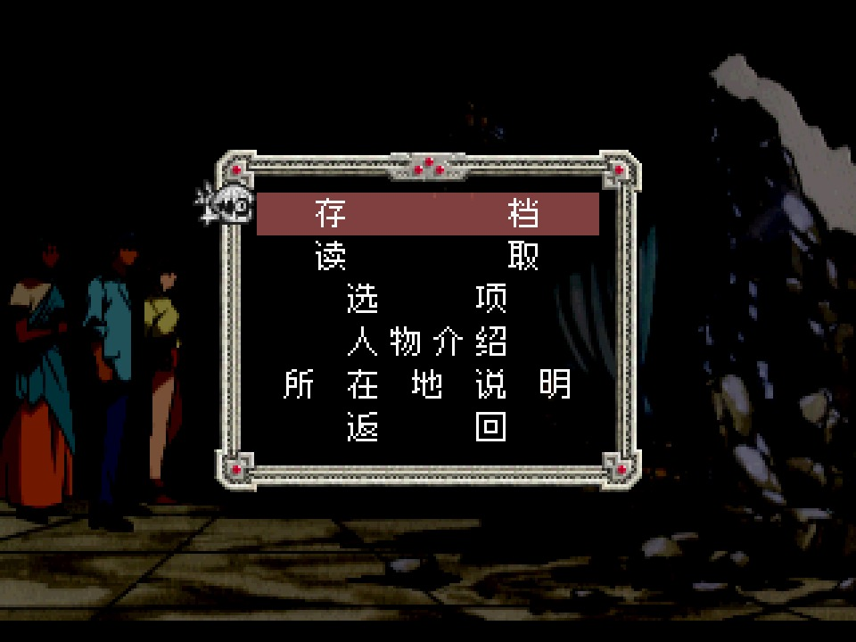
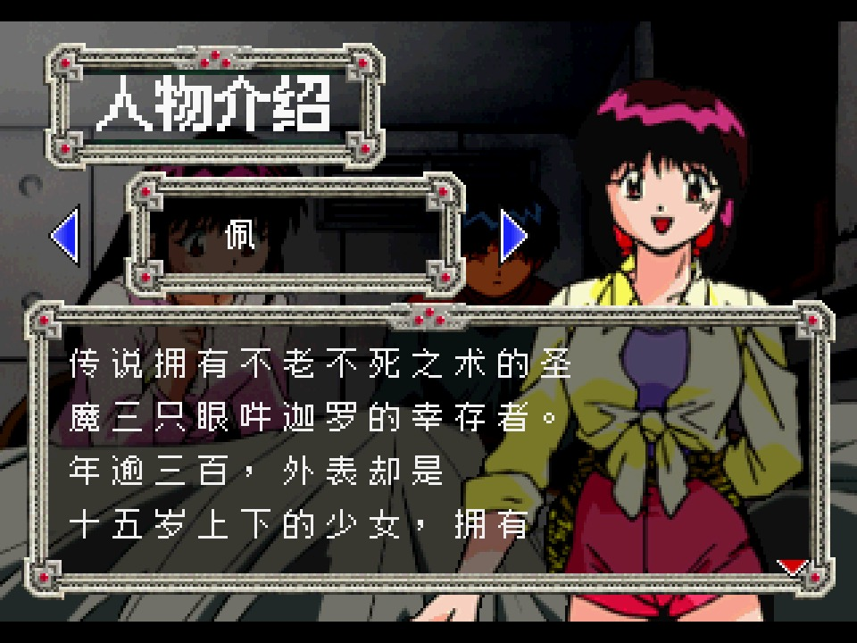
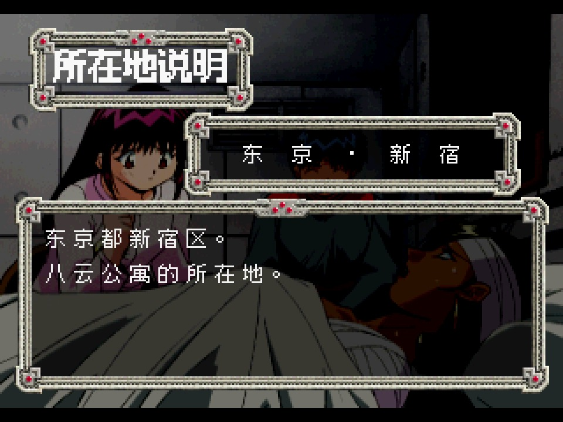
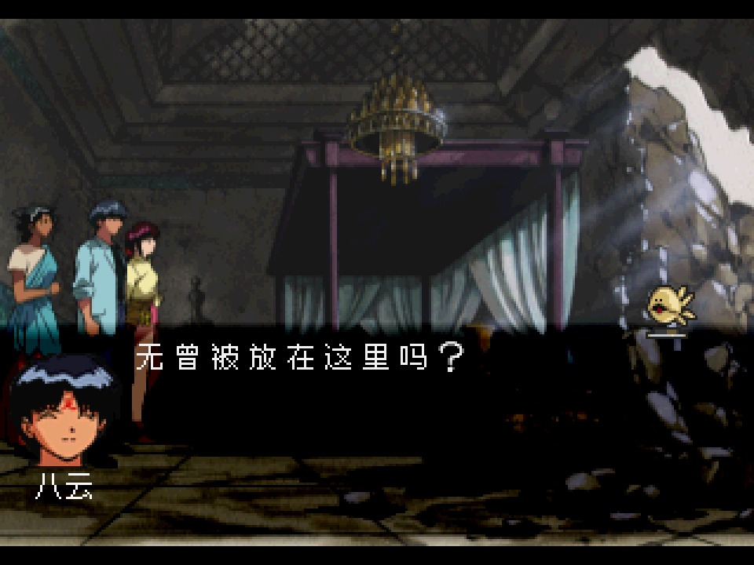

# 三只眼 转轮王幻梦 · 简体中文汉化 v6.9

**3x3 Eyes: Tenrinou Genmu（3×3 EYES 〜転輪王幻夢〜, PS1, SLPS-01497 / 01498 / 01499）— Simplified Chinese translation patch v6.9**

作者：**自由之紫Roy** ｜ 发布：2026-11-02 ｜ [补丁下载](https://github.com/realsquall1980-art/3x3-eyes-tenrinou-genmu-zh/tree/main/patches)

本作 1998 年 8 月 6 日由 King Records 在日本发行，三碟装，日版独占。这是本人自制的粉丝汉化；如果你发现更早的公开版本，欢迎开 issue 指正。
这个仓库只放**补丁、文档与截图**：不含游戏本体、不含 BIOS，你需要自备日版原盘。

---

## 汉化范围（v6.9）

| 部分 | 内容 | 状态 |
|---|---|---|
| 剧情对白 | 全流程对话文本 | 中文 |
| 过场动画字幕 | 18 段有语音动画，695 句，中日双语叠印（另 5 段盘上音轨实测为静音，无台词） | 中文＋日文对照 |
| 标题画面 | 四行菜单与「自由之紫Roy汉化」署名 | 中文 |
| 主菜单 / 游戏内暂停菜单 | 存档、读取、选项、人物介绍、所在地说明、返回（6 行） | 中文 |
| 人物介绍屏 | 角色名 + 简介正文 | 中文 |
| 所在地说明屏 | 地名 + 说明正文 | 中文 |
| 存 / 读档与存档槽界面 | — | 中文 |
| 角色名牌 | 改用 Zpix 细体中文字模 | 中文 |
| 「三只眼变成」图文精选（整节） | 按作者要求保留 | **日文原文** |

| 画面 | 内容 |
|---|---|
|  | 游戏内暂停菜单六行全中文 |
|  | 人物介绍屏：角色名与正文 |
|  | 所在地说明屏 |
|  | 剧情对白与说话人名牌 |

## 本版修什么（v6.9）

修「菜单 / 人物介绍进去没有文字」：v6.4 做存档对齐时把菜单文本块整段后移了 8 字节，v6.9 把该文本块恢复成母盘布局——暂停菜单六行与人物介绍屏正文恢复显示中文。

## 已知取舍（如实说）

- **对齐方式回退**：v6.4 曾把「读取 / 存档」做成一格居中对齐，这种改法会破坏菜单文本块结构；本版回退成母盘布局，两字间距与原版一致。**优先保证文字完整显示**。
- **旧存档**：v4 以前的旧存档与新字表码位错配会显示乱码，首次进入请删旧档重开新档。
- **保留原文**：「三只眼变成」图文精选整节、片名美术字 3×3 EYES 〜転輪王幻夢〜 保留原文。
- 补丁只适用于 **日版原盘 SLPS-01497 / 01498 / 01499**，别区版本不适用。

## 安装

**先核对底包，再打补丁。** 完整步骤（含掌机 CHD 转换、换盘、常见错误）见 [docs/patch-guide.md](docs/patch-guide.md)。

最简版本：

1. 准备 Redump 日版对应碟的 `Track 1` BIN（三碟各一）。
2. 用 UPS 打补丁工具（Windows：UPS Patcher / RomPatcher.js；macOS：`flips`）把对应碟的 `.ups` 打到该碟 `Track 1` BIN 上。
3. 用打好的 Track 1 覆盖原盘同名文件，保留原盘其余 Track 与 `.cue`，用模拟器直接打开 `.cue`。

底包与成品校验值见 [SHA256SUMS.txt](SHA256SUMS.txt)，对不上就是拿错盘了。

> **下载卡在几百 KB 不动？** 这是 GitHub 文件域名在中国大陆的线路问题，不是文件坏了。把原链接前面加上 `https://gh-proxy.com/` 再下即可。

## 模拟器兼容

- **pcsx_rearmed（本作验收内核）**：通过——全流程冷启动录制，标题 / 菜单 / 人物介绍 / 所在地说明 / 对白逐屏实拍。
- **SwanStation / DuckStation**：可运行（本作在部分 ReARMed 构建下的黑屏为原版盘固有现象，与补丁无关）。

验收口径与证据链见 [docs/verification.md](docs/verification.md)。

## 视频实机演示

B站 2 分钟实机演示（含原版 vs 汉化同机位对比）：<https://www.bilibili.com/video/BV1D3xt6fE7V/>

## 许可

补丁文件、本仓库文档与截图版权归 **自由之紫Roy** 所有，以 **CC BY-NC 4.0**（署名—非商业性使用）授权。
转载须署名，**禁止任何收费分发、打包售卖或商业捆绑**。详见 [LICENSE.md](LICENSE.md)。

原作《3×3 EYES》版权归 **高田裕三** / 講談社；游戏版权归 **King Records** 及原权利人。本项目为非盈利的粉丝汉化，与原权利人无隶属关系。
